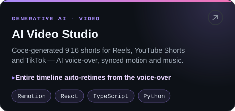
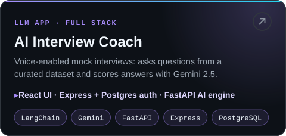
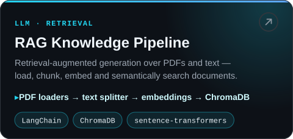
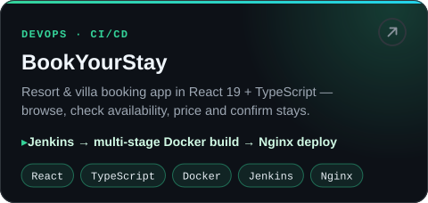
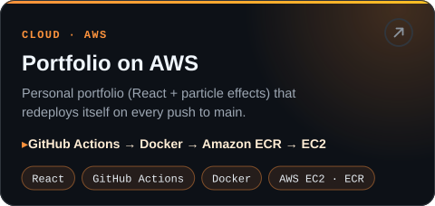
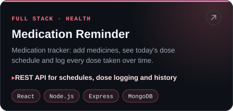
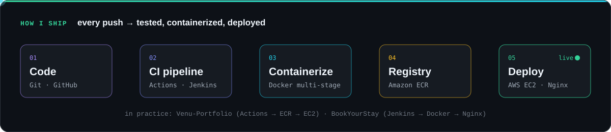

  

  
  
  

## 👋 About me

I build **AI products end to end** — from LLM and RAG pipelines, to the React apps people actually use, to the CI/CD that ships them. Currently an **AI/ML Developer at Cluco**, automating real-world workflows with LLMs.

- 🧠 **AI / LLM** — RAG pipelines (LangChain, ChromaDB, embeddings), Gemini-powered assistants, résumé-tailoring automation, XGBoost models
- 💻 **Full stack** — React 19 + TypeScript front ends; FastAPI, Flask and Node/Express back ends; PostgreSQL, MongoDB, SQLite
- ⚙️ **DevOps** — multi-stage Docker builds, Jenkins and GitHub Actions pipelines, AWS (EC2, ECR, Lambda)
- 📍 Remote, USA  ·  💬 **Open to AI/ML, full-stack and DevOps roles**

## 💼 Experience

**AI/ML Developer — Cluco** &nbsp;·&nbsp; Dec 2025 – Present · Remote, USA
- Built **JobGrid**, an AI engine that generates a résumé tailored to each job description and tracks the status of every application.
- Automated U.S. immigration filings (e.g. Form I-90) by generating applications from user-uploaded documents, cutting manual work for attorneys.
- Connected a React front end to a Python back end, designed SQLite schemas, and automated workflows with AWS Lambda.

**Software Developer — Uncalled Innovaters** &nbsp;·&nbsp; Jun 2025 – Nov 2025
- Built a real-estate valuation engine: Pandas/NumPy data cleaning, XGBoost regression, served through a Flask API.
- Engineered the back end of a peer-to-peer heavy-machinery rental marketplace and real-time hackathon-tracking modules.

**Earlier:** Full-Stack Developer Intern (2025) · AI/ML Virtual Intern — house-price regression models (2024)

## 🚀 Featured projects

  
  

  
  

  
  

  Also: <a href="https://github.com/PathipatiVenu/Italy-travel"><b>Italia Luxe</b></a> — luxury travel site with a 3D animated hero (React Compiler + Motion)
  &nbsp;·&nbsp; <a href="https://vaneedika-village-vihar.vercel.app"><b>Pranavam Heritage Retreat</b></a> — live resort website with a WhatsApp booking estimator

## 🛠️ Tech stack

| Area | Tools I use |
|---|---|
| **AI / ML** |        |
| **Languages** |     |
| **Frontend** |      |
| **Backend & data** |         |
| **DevOps & cloud** |       |

## ⚙️ How I ship

  

## 📫 Let's talk

Hiring for **AI/ML, full-stack or DevOps**, or building something with LLMs? The fastest way to reach me is
**[LinkedIn](https://www.linkedin.com/in/venu-pathipati-903a83290/)** or **[email](mailto:venupathipati1@gmail.com)**.

Thanks for stopping by ✨

